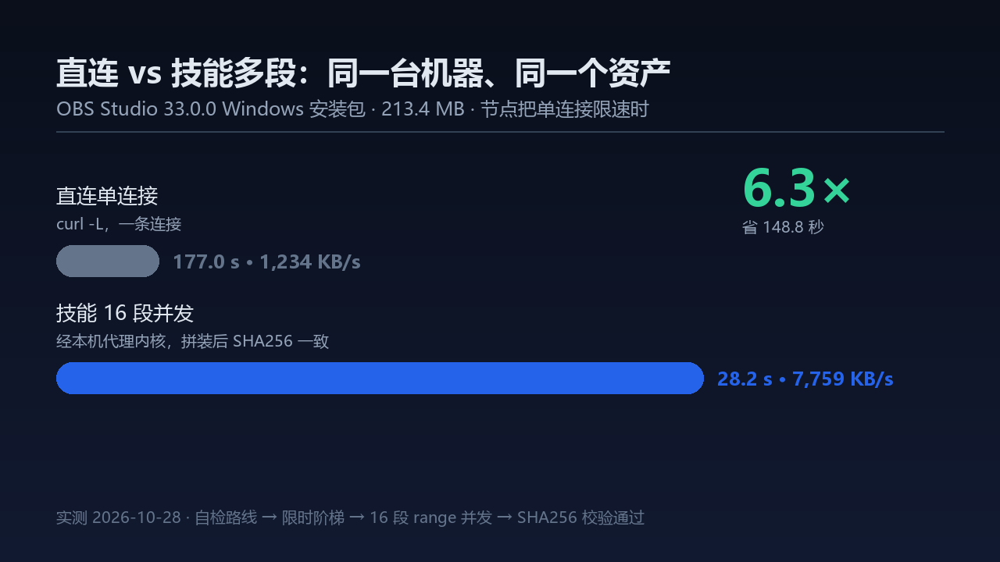
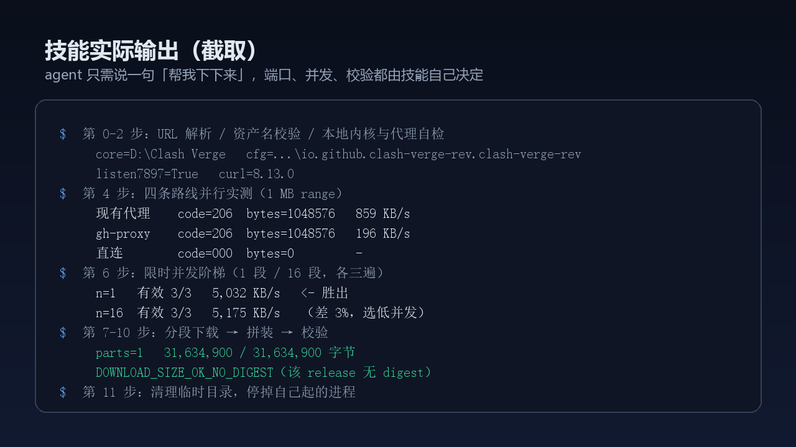

# GitHub Release 下载加速（github-release-download-acceleration）

一个零依赖的 Windows PowerShell 技能：用户只说「这个包下太慢了」，它自己探清机器家底、实测选出最快路线、单流或分段并发下载，最后用 release 自带的 `digest` 做 SHA256 闭环校验。

## 1. 项目解决什么问题

GitHub Release 的大资产（几十到几百 MB 的安装包、便携包）在国内网络下经常出现三种情况：

- **直连被限速**：`release-assets.githubusercontent.com` 前几秒还快，随后掉到几百 KB/s，一个 200MB 的包要等好几分钟。
- **公共镜像不可靠**：`ghfast.top`、`ghproxy.net`、`github.moeyy.xyz` 这类镜像随时可能 TLS 握手超时、返回错误页，或者比直连还慢。
- **本机其实有代理能力**：很多人装了 Clash Verge，但内核没在跑、系统代理没开，命令行下载完全用不上它。

手工排这些可能性很费时间，而且「装个 aria2 / 7z 再研究参数」对环境要求太高。本技能把这件事变成一条命令：**不装东西、不改系统代理、不问用户参数**，自己把上面这些路线实测一遍再决定怎么下。

## 2. 主要功能

| 能力 | 具体行为 |
| --- | --- |
| 环境自检 | 查 `curl.exe`、环境变量代理、系统代理、常见代理端口是否在监听；`ProxyServer` 残留值不算数，只有端口真的 Listen 才算 |
| 四类路线并行实测 | A 现有代理 / B 无头拉起本机 Clash Verge 内核（`127.0.0.1:7897`）/ C 六个公共镜像 / D 直连，各跑一次 1MB range GET，按「先看是否真拿到 ≥512KB 数据，再看 KB/s」排序 |
| 资产名校验闸门 | 测速前先用 release API 校验资产名；名字对不上就报 `ASSET_NOT_FOUND`，列出全部真实候选（名字 + MB）和最接近的一条，**停下等用户确认，绝不静默换名继续下** |
| 并发阶梯（先判值不值得测） | 只有「资产 ≥100 MB **且** 单连接探针 <3 MB/s」才测——探针就是第 5 步那个 8 MB 单连接 GET 的 `$singleKB`，不额外花流量。测的时候 1/16 两档 × 三遍、限同一时间窗（4 秒）比聚合吞吐，取中位数并报 min–max；胜出档还要满足「完成数 n/n、三次波动 ≤2×」，两档中位数差 10% 以内选低并发，多段比单段快不到 1.25 倍就用单流。小包或单连接已经够快时**跳过整个阶梯**（省下约 24 秒与上百 MB 采样流量），`$ForceLadder = $true` 可强制测 |
| 单流 / 分段两条下载路径 | `$winN=1` 或 `<100MB` 走单流一次拿完；大资产按 `$winN` 段并发，每段独立日志、带 `--retry`，`--retry-all-errors` 仅在 curl ≥7.71 时启用 |
| 下载中自愈 | 45 秒看一次增长，20–30 秒还是 0 字节就只杀自己的 curl、清空分片、降并发（16→8→4）或切第二路线重开 |
| digest 闭环校验 | 拼装前核对分片总字节，拼完比对 `size` 与 SHA256；无 digest 的老 release 只报「字节数一致」，绝不冒充校验通过 |
| 收尾还原 | 只停自己起的进程、只删自己建的目录，确认 7897 不再监听、`ProxyEnable` 与开始时一致 |

它明确**不做**的事：不装 aria2/7z/winget，不写注册表代理项，不开 Clash GUI，不把 `allow-lan` 打开，不杀用户的其它下载进程。

## 3. 安装方法

技能就是一个目录，放进宿主的技能发现根即可。

```
github-release-download-acceleration/
├── SKILL.md              # 技能正文：决策表 + 错误路径 + 12 步流程（0–11） + 维护说明 + Pitfalls
├── README.md             # 本文件
├── LICENSE               # MIT 许可证
├── package.json          # 插件清单：声明 dsh.bundle.patch（市场只收带 dsh.bundle 的包）
├── cordis.patch.yml      # bundle patch：把本插件插进 profile 的 loader 树
├── index.js              # 技能 provider：把包里的 SKILL.md 挂进 ctx.skills（零依赖）
├── agents/
│   └── openai.yaml       # Codex/OpenAI 宿主的展示元数据（DSH 不读这个文件）
├── scripts/
│   └── validate.ps1      # 自检脚本：结构 / frontmatter / 5.1 兼容性 / 代码块语法
├── assets/               # 市场卡片图标与实测截图
└── screenshots.json      # 声明 1-8 张截图（市场详情页读取，放 package.json 旁边）
```

**DeepSeek Harness（DSH）**

1. 项目级：放到 `<项目根>/.dsh/skills/github-release-download-acceleration/`（`<项目根>` = 最近含 `.git` 的祖先目录）。
2. 用户级：放到 `%USERPROFILE%\.dsh\skills\github-release-download-acceleration/`（即 `C:\Users\<用户名>\.dsh\skills\`）。
3. 若技能目录本身不在任何含 `.git` 的项目里（比如它自己就是项目根，而你没有 init git），DSH 会把 `projectRoot` 退化成当前会话目录，此时用目录联接把它挂进用户级技能根即可：

```powershell
$src = '<技能所在目录>\github-release-download-acceleration'
$dst = "$env:USERPROFILE\.dsh\skills\github-release-download-acceleration"
if (-not (Test-Path $dst)) { cmd /c mklink /J "$dst" "$src" }
```

挂好后用宿主的 `skill` 工具**真正加载一次**验证；只看目录存在不算数（DSH 会对技能目录热加载）。

4. 插件方式（推荐，和插件市场一致）：

```powershell
dsh plugin add github:chenjrastro-tech/github-release-download-acceleration
```

包装层就是 `package.json` + `cordis.patch.yml` + `index.js` 三个文件：DSH 装上后由 `index.js` 把包内的 `SKILL.md` 注册成技能（`source: bundled`、rank 600）。因此它同时是「能手动放的技能目录」和「能用 `dsh plugin add` 装的插件包」，两条路读的是同一份 `SKILL.md`，不会出现两份正文漂移。

5. 也发布到了 npm，但包名不叫 `github-release-download-acceleration`，而是 **`github-release-accelerator`**：

```powershell
npm i github-release-accelerator
```

原因：npm registry 拒绝包名里出现 `download` 这个词（`400 That word is not allowed`），所以发布名去掉了它；仓库名与技能名保持不变（仍为 `github-release-download-acceleration`）。npm 包与 `dsh plugin add` 装的是同一份代码，在 DSH 里建议用上面第 4 条。

**其它基于 SKILL.md 的宿主**（Codex 等）：把整个目录放进其技能目录，`agents/openai.yaml` 提供 `display_name` / `short_description` / `default_prompt` 展示信息。

**环境要求**：Windows 10/11 + Windows PowerShell 5.1 + 系统自带 `curl.exe`（Win10 1803+ 自带）。没有任何第三方依赖。

## 4. 使用方法

直接用自然语言说，不需要报端口、代理地址、并发数或仓库名。

**给了 release 直链**

```text
帮我把 https://github.com/obsproject/obs-studio/releases/download/33.0.0/OBS-Studio-33.0.0-Windows-x64.zip 下下来，太慢了
```

**只给 tag 页**（技能会自己挑最大的资产，并说明选择理由）

```text
github.com/neovim/neovim/releases/tag/v0.11.0 这个包下不动，你看着办
```

**文件名可能记错**（技能会先校验，对不上就停下等你确认）

```text
https://github.com/junegunn/fzf/releases/download/v0.65.2/fzf-0.65.2-windows-x64.zip 帮我下这个
```

可选地给一个目标目录（例如 `下到 D:\Downloads\_dl`）。不给目标目录时由宿主任选一个**不含空格**的落地目录（第 7 步会拒绝含空格的路径——5.1 的 `Start-Process` 会把 `-o` 参数拆坏），并在报告里给出绝对路径。

内部执行顺序固定为：`解析 URL → 环境自检 → 定位内核与配置 → API 校验资产名 → 并行探测路线 →（必要时）无头起内核 → 按需阶梯（<100MB 或单连接已够快则跳过）→ 下载 → 监控/降档 → 拼装 → digest 校验 → 收尾`。

### 一次性 runner（宿主只能执行一条命令时）

有些宿主只肯跑一次本地命令，没有「逐块读文档再执行」的能力。这种场景用 runner，一条命令走完全流程：

```powershell
# Windows：PowerShell 5.1 与系统 curl 都自带，不需要装任何东西
powershell -NoProfile -File scripts\ghdl.ps1 -Url '<release 直链>'
powershell -NoProfile -File scripts\ghdl.ps1 -Url '<release 直链>' -OutDir 'D:\Downloads'
powershell -NoProfile -File scripts\ghdl.ps1 -Url '<release 直链>' -ForceLadder   # 强制单流 vs 多段对照
powershell -NoProfile -File scripts\ghdl.ps1 -Url '<release 直链>' -Parts 16      # 手动指定并发段数
powershell -NoProfile -File scripts\ghdl.ps1 -Url '<release 直链>' -ForceClean    # 删旧分片/旧输出，强制重下
powershell -NoProfile -File scripts\ghdl.ps1 -Url '<release 直链>' -KeepParts     # 校验通过也保留分片（排查用）

# 任意直链也能用（自建 CDN / GitLab / 内网制品库），只做字节数校验
powershell -NoProfile -File scripts\ghdl.ps1 -Url 'https://example.com/big.bin'
```

行为约定（agent 可以直接依赖）：

- **幂等**：目标文件已存在且字节数（有 digest 时再加 SHA256）都对 → `ALREADY_DONE` 直接跳过，不重下。
- **可续传**：分段方案写在 `_dl_parts/manifest.json`；中断后重跑，`RESUME_PLAN` 沿用上次分段，已下分片跳过。
- **不留双写**：上次被强杀留下的 curl 还在写同一目录时，先 `ORPHANS_KILLED` 清掉再开工。
- **退出码**：`0` 只有在校验通过时才返回；`DOWNLOAD_VERIFY_FAILED` / `SEGMENT_SIZE_MISMATCH` / `NO_ROUTE` 都是 `1`。
- **失败保留现场**：校验没过时分片不删（`PARTS_KEPT`），下次接着下；确认不要了再加 `-ForceClean`。

```sh
# macOS / Linux：行为对齐 ps1，仅在 Git Bash 上验过（真机 mac/Linux 未实测，见「支持矩阵」）
sh scripts/ghdl.sh '<release 直链>'
```

`scripts/ghdl.ps1` 不是手写的：`scripts/build-runner.ps1` 把 `SKILL.md` 第 0–11 步的代码块拼成它（只替换 URL/输出目录/强制阶梯三处），`validate.ps1` 会比对两者，改了文档不重生成就 FAIL。

### 并发引擎（P2）：自适应段 + 多源 + 工作窃取

- 段大小由单连接实测速度决定（每段约 4 秒的活，夹在 2MB–24MB），不再硬编码 16 段。
- 路线池只收「回 206 且速度 ≥ 最快路线 35%」的前三条；慢路线混进来会让 1/3 的段轮流卡住。
- 并发从 4 条起步：3 秒窗口里吞吐涨 15% 就 +2 条，卡住 2 段就砍一半。实测硬上 16 段会被节点重置（同一资产 173s），自适应后 32s。
- 某段 6 秒不长进就算卡住：杀掉、按已下字节续传、换下一条路线重新排队，空闲 worker 接手——这就是工作窃取。
- `GHDL_PARALLEL=1` 且 curl ≥ 7.66 时走单进程 `curl --parallel`（命令行 `--next` 分组；实测 `-K` 配置文件里的 `next` 只跑第一段）。

同机实测（2026-10-30，OBS 223.7MB，同一时段、同一节点）：

| 方式 | 耗时 | 说明 |
| --- | --- | --- |
| 单流（基线） | 31.2s（7.0 MB/s） | 节点没限速时本来就快 |
| 自适应窃取 `-Parts 16` | 32.3s | `RAMP_UP 4→6→8`、`BACKOFF→4`，`steals=5 repairs=5` |
| `--parallel` 快路径 | 31.6s | 18 段一次拉完，`steals=0` |
| 中途杀掉一条 curl | 30.7s | `steals=2 repairs=3`，续传补齐后校验通过 |

结论：节点不限速时并发不会更快，引擎会自己退回单流；只有单连接被限速时才有收益（历史实测 6.3×）。

**≥1GB 资产实测**（Godot 4.7.2 mono export templates，1,202,598,411 B）：不带 `-Parts` 时按闸值直接单流（176.9s，SHA256 与 digest 一致）；`-Parts 8` 时 `PLAN: nseg=49 chunk=23.4MB`，49 段 `steals=27 repairs=27`，同样校验通过。段数上限是 128（不是 64）：本地 1.75GB 用例 `-Parts 4` 跑出 `nseg=75`，证明段数超过 64 时引擎仍正常（10.8s、字节精确）。

**「真零前置」的可验证定义**：PATH 只留系统目录、清空 `HTTP_PROXY`/`HTTPS_PROXY`/`ALL_PROXY`、不登录任何账号、非管理员用户，仍能完成一次真实下载并通过校验。Windows 侧已按这个口径实测通过——非管理员会话、PATH 只剩 `C:\Windows{,\system32,\System32\WindowsPowerShell\v1.0}`，靠端口探测找到本机 7897，最后 SHA256 与 release digest 一致。

## 5. 输入输出示例

**输入**：一个 GitHub release 直链或 tag 页；可选目标目录。

**成功（大资产，分段）**

```text
路线=本机 Mihomo 内核 127.0.0.1:7897（16 段并发）
已下载并校验通过：213.4 MB，平均 7.6 MB/s，SHA256 与 release digest 一致
文件=D:\Downloads\_dl\OBS-Studio-33.0.0-Windows-x64.zip
```

**成功（小资产，单流）**

```text
SINGLE exit=0 code=200|got=1863156|speed=1238384|t=1.504514
已下载并校验通过：1.8 MB，SHA256 与 release digest 一致
文件=D:\Downloads\_dl\fzf-0.65.2-windows_amd64.zip
```

**资产名对不上（唯一必须回问用户的情况）**

```text
ASSET_NOT_FOUND: 你给的 'fzf-0.65.2-windows-x64.zip' 不在 junegunn/fzf@v0.65.2 里。真实候选：
  - fzf-0.65.2-windows_amd64.zip  (1.8 MB)
  - fzf-0.65.2-windows_arm64.zip  (1.7 MB)
  ...
最接近的是 'fzf-0.65.2-windows_amd64.zip'；把确认后的完整下载链接发我，我不会静默替换文件名继续下。
```

**其它失败状态**（都带判定词，不写「玄学变慢」）

```text
RELEASE_NOT_FOUND: obsproject/obs-studio@33.0 不存在（API 404）——先确认 tag，别去猜资产名
NO_ROUTE: 7 条路线全部不可用（gh-proxy 000 / ghfast 000 / 直连 000 …），未开始下载
SPACE_LOW: free=0.2GB need=0.4GB

# 校验失败：先打印实测/期望，再给结论
size=223737114 expect=223737114 sizeOk=True
sha256=<实测 hex> expect=<digest hex> shaOk=False
DOWNLOAD_VERIFY_FAILED

# 老 release 没有 digest
NO_DIGEST: 该 release 未提供 sha256，只能保证字节数一致
DOWNLOAD_SIZE_OK_NO_DIGEST

# API 被限流（代理出口 IP 常见）：连 digest 都拿不到，降级为只保证字节数
API_RATE_LIMITED: GitHub API 403 rate limit exceeded for <ip> → 无 digest
DOWNLOAD_SIZE_OK_NO_DIGEST
```

### 跨平台：Windows 与 macOS 两个 runner

| 平台 | 入口 | 依赖 |
| --- | --- | --- |
| Windows | `scripts\ghdl.ps1 -Url '<url>' [-OutDir <目录>] [-Parts 16] [-ForceClean] [-KeepParts] [-ForceLadder]` | 系统自带 `curl.exe`（Win10 1803+） |
| macOS / Linux | `bash scripts/ghdl.sh '<url>'` | 系统自带 `curl`；SHA256 走 `openssl` → `shasum` → `sha256sum` |

```bash
# macOS/Linux：参数走环境变量
OUTDIR=$HOME/Downloads PARTS=16 bash scripts/ghdl.sh 'https://github.com/owner/repo/releases/download/v1.2.3/a.zip'
MIN_KBPS=200 P2SP_URLS='https://cdn.example.com/a.zip' bash scripts/ghdl.sh '<url>'   # 3 秒内 <200KB/s 就掐断换源，并与备源混拨
```

两边共用同一套阈值：frontmatter `metadata`、正文「可调参数」表、ps1 的 `$ladderMinMB`/`$fastKB`、sh 的 `LADDER_MIN_MB`/`FAST_KBPS`，四处不一致 `validate.ps1` 直接 FAIL。

macOS 侧的实现差异（都写进脚本头部注释）：

- `nc -z -w 1` 探端口（无 `nc` 回退 curl），不用 `/dev/tcp`；
- `ulimit -n 4096`，抬不上去打印 `ULIMIT_SKIP` 继续；
- `--http2`/`--buffer-size`/`--proxy-http2` 先用 `curl <opt> --version` 探测运行时是否支持（本机 curl 8.22 的 `--help` 会骗人）；
- worker 池用队列文件 + `mkdir` 原子锁，`xargs -P` 做不了单段自愈；
- 冒烟按后缀：`.zip`→`unzip -tqq`、`.tar.*`→`tar -tf`、`.exe` 在 macOS 上 `smoke=SKIP`。

## 实测效果

同一台机器、同一个 213.4MB 资产（obs-studio 33.0.0 Windows x64）：

| 方式 | 用时 | 平均速度 |
| --- | --- | --- |
| 直连单连接 `curl -L` | 177.0 s | 1,234 KB/s |
| 本技能（无头内核 7897 + 16 段并发） | 28.2 s | 7,759 KB/s |

**6.3 倍**，省约 149 秒，SHA256 与 release digest 一致。

但并发收益取决于节点是否限速。同一天节点恢复后、同一 31.6MB 资产（rclone）的整包对照：

| 方式 | 用时 | 平均速度 | 相对 |
| --- | --- | --- | --- |
| 单流经 7897 | 5.3 s | 5,829 KB/s | 1.00× |
| 16 段经 7897 | 7.4 s | 4,175 KB/s | 0.72× |

即**节点不限速时多开线程是负收益**，1/4/16 三档中位数 5.7 / 5.1 / 5.2 MB/s 基本持平；只有在单连接被限速时（上面的 1,234 KB/s 场景）并发才有 1.5–6 倍收益。

而阶梯本身也不便宜——两档 × 三遍 × 4 秒实测 **26.1 秒**，节点快时还要顺带下载上百 MB 采样流量。所以现在的判定顺序是**先检验前提，再决定要不要花这笔测量费**：

| 场景 | 行为 | 实测 |
| --- | --- | --- |
| 资产 <100 MB | 直接单流，跳过阶梯 | rclone 31.6 MB：`SKIP_LADDER` → 7.09 s / 4,462 KB/s，`DOWNLOAD_VERIFIED_OK` |
| 单连接探针 ≥3 MB/s | 直接单流，跳过阶梯 | 同日 `singleKB=4257`，阶梯测了也只有 0.72× |
| 资产 ≥100 MB 且单连接 <3 MB/s | 测 1/16 两档，1.25 倍门槛 | 限速节点上 16 段 7.7 MB/s ≫ 直连 1.2 MB/s |

这两个阈值是可调的，写在 SKILL.md 的 frontmatter 里（`metadata` 段）。**实际文件里就是这个样子，值带引号、不写行内注释**（宿主的 frontmatter 解析器未必吃注释，省掉最稳）：

```yaml
metadata:
  min_size_for_ladder_mb: "100"
  single_conn_fast_kbps: "3072"
```

含义：`min_size_for_ladder_mb` 是「小于它直接单流」的资产下限（MB），`single_conn_fast_kbps` 是「单连接探针不低于它就直接单流」的速度门槛（KB/s，3072 = 3 MB/s）。改完跑一遍 `validate.ps1`，它会校验代码里那一份有没有跟着改：

```powershell
# 只改 frontmatter、忘了同步代码 → 自检直接失败，不会带着不一致的阈值上线
[FAIL] metadata.min_size_for_ladder_mb=80 与代码 $ladderMinMB = 100 不一致：改阈值要两处同步
```

强制测阶梯（`$ForceLadder = $true`）时的实测形状：1 段中位 4,944 KB/s（4,471–5,893，波动 1.32×）、16 段中位 5,043 KB/s（4,305–5,632，波动 1.31×）→ 未过 1.25 倍门槛，`winN=1`。

功能回归（2026-10-28，把 SKILL.md 的代码块原样抽出来按顺序 dot-source 执行，不是另抄一份）：

| 用例 | 资产 | 结果 |
| --- | --- | --- |
| 小资产 · 跳过阶梯走单流 | `rclone/rclone` v1.75.2 · 30.2 MB | 15/15 通过：`SKIP_LADDER` → `winN=1` → `SINGLE exit=0 code=200`（7.09 s / 4,462 KB/s）→ `DOWNLOAD_VERIFIED_OK` |
| 强制阶梯 | 同上 | 6 次采样（1/16 各三遍）、2 行汇总、无 4 段档、`winN=1`，耗时 26.1 s |
| 错误路径 | 不存在的 asset；`digest: null` 的老 release | `ASSET_NOT_FOUND` + 候选清单；`NO_DIGEST` + `DOWNLOAD_SIZE_OK_NO_DIGEST` |

### 本地回归测试（P3，离线、确定性）

```powershell
powershell -NoProfile -ExecutionPolicy Bypass -File tests\run-tests.ps1
# 端口默认自动挑空闲的；要复现/排查时指定：-Port 19000
# 端口被上一次异常中断留下的 serve.ps1 占着时，会先 SERVER_REAP 清掉再起新的（只清本仓库 tests\serve.ps1）
# TESTS_OK: 34 项通过

# POSIX runner 的同款离线回归（本地假服务器 + 确定性 SHA256）
bash tests/run-tests-sh.sh
# TESTS_SH_OK: 11 项通过   （覆盖单流/8 段/续传/不支持 Range/404/截断包/P2SP 双源）
# Windows 上跑要给真实解释器：PYTHON=C:/path/to/python3 bash tests/run-tests-sh.sh
```

`tests/serve.ps1` 用 `TcpListener` 在本机起一个假 Release 服务（支持 Range，也能模拟「只发 700KB 就断」和「根本不支持 Range」），
`scripts/ghdl.sh` 同样支持任意 https 直链（`sh scripts/ghdl.sh <url>`，输出目录用 `OUTDIR`）、断点续传与幂等。

`tests/run-tests.ps1` 会先用 1 字节 range 请求验明「端口上跑的确实是本仓库的 serve.ps1」，不是就直接报错退出（避免复用旧实例导致假失败）；然后跑 12 组场景 34 条断言：单流、幂等重跑、`-ForceClean`、16 段分段（123,456,789 B，非段长整数倍）、
续传（预置 manifest + 半个分片）、坏分片（长度不符）、短包、无 Range 服务器、全灭路线。
不需要外网、不需要 GitHub 账号、不需要装任何东西；跑完自动清 `%TEMP%\ghdl_tests`（加 `-Keep` 保留现场）。

**不覆盖**：digest 不匹配（要真 release）、`ASSET_NOT_FOUND`（要 GitHub API）、磁盘不足（要真满盘）——这三条只能真实环境验。

## 截图

节点把单连接限速时的对照（213.4 MB：177.0 s → 28.2 s）：



节点不限速时并发是负收益（30.2 MB：单流 5,829 KB/s vs 16 段 4,175 KB/s，0.72×）：


技能跑完一次真实下载的实际输出（截取）：



## 自检

```powershell
powershell -NoProfile -ExecutionPolicy Bypass -File scripts\validate.ps1
# VALIDATE_OK: 0 个错误 / 0 个告警
```

`validate.ps1` 检查：必需文件、frontmatter（`name` 与目录名一致、`description` 长度、未知键告警）、**`metadata` 里的两个阈值与正文 `$ladderMinMB`/`$fastKB` 是否一致**、`## Steps` / `## Pitfalls` / `## Verification` 三节、每个 `powershell` 代码块的 5.1 语法、禁用写法（`(if …)` 括号陷阱与 `& curl … 2>&1` 记为**错误**，`+= 管道` 记为**告警**）、以及 `agents/openai.yaml` 的字段长度与 `$skill` 引用。**退出码非 0 就是文档有问题。**

## 变更记录

### 0.3.1（未发布）
- 新增 POSIX runner `scripts/ghdl.sh`（macOS/Linux），行为对齐 ps1：`nc` 探端口、`ulimit -n 4096`、哈希降级链、队列锁 worker 池、单段自愈、逐段强校验、manifest 续传、P2SP 双源混拨、`--connect-timeout 3` + `--speed-limit/--speed-time` 掐死慢段、不支持 Range 秒退单流、按后缀冒烟。
- 新增 `tests/serve.py` + `tests/run-tests-sh.sh`（7 组 11 断言，离线确定性），Windows 侧套件保持 34 断言。
- SKILL.md 增加「环境分发」「可调参数」「支持矩阵」三节；阈值四处一致性纳入 `validate.ps1`（2c 段）。
- 修 `-Parts` 语义：现在严格等于「段数」（之前只影响 workers，123MB 资产会退化到 5 段）。
- 修 worker 池空路线导致的 `Attempted to divide by zero`（`POOL_EMPTY` 明确报错 + `$poolN` 兜底）。
- **未实测**：macOS/Linux 真机；只在 Windows Git Bash（MINGW64）与 Windows PowerShell 5.1 上跑过。

**0.3.0 发布后（main 分支，未发布）**：几项纯性能收尾，仍记在 **0.3.0** 这个大版本下，不单独升版本号；下一次有大内容更新才用 0.3.1。参照物是已发布的 `0.3.0` tag，同机同资产、轮流跑：

| 场景 | 0.1.0 | 0.3.0（已发布） | main（0.3.0 + 未发布收尾） |
|---|---|---|---|
| 本地限速服务器 105MB（每连接 1.2MB/s，确定性） | 47.4s / 47.3s | 46.8s / 46.7s | **40.7s / 40.6s** |
| 真实 rclone 30.2MB | 19.8s / 16.3s | 22.5s / 19.6s | **14.0s** |
| 真实 OBS 213.4MB（节点在漂移，看吞吐段） | 传输约 30s | 传输约 31s | 传输约 25–31s |

- **端口探测并发化**：11 个端口串行 `600ms` 共 **6.2s** → 一次发起全部连接、总共只等 `400ms`，实测 **0.4s**（关着的端口在本机不一定立刻回 RST，串行就是白等）。
- **已有代理在监听时跳过「全盘 + 开始菜单递归」找内核**：**5.6s → 0**；没有代理可用的机器行为不变（照旧全盘扫）。
- **<100MB 资产跳过 8MB 单连接测速**：30.2MB 资产 **22.5s → 14.0s**。反正 <100MB 一律单流，这个 8MB 请求只是为了量单连接速度，纯浪费。
- **段划分按 worker 数取整**：105MB 资产 23 段 × 4.6MB（首波 16 条，第二波只剩 7 条）→ 16 段 × 6.9MB，下载 **8.5s → 5.9s**。
- **起始并发直接用阶梯结论**：`ratio ≥ 4` 起步即满并发、`≥1.25` 从 8 条起。此前只从 4 条起、靠「窗口涨幅 15%」爬坡，而每连接限速且已跑满时涨幅恒为 0 —— **会永远卡在 4 条**（本地对照：4 条 25s vs 16 条 5.9s）。
- 回归：`validate.ps1` 0 错误 / 0 告警，离线套件 **34/34**。

**0.3.0（2026-10-30）**：第一个可以长期用的版本。仓库内部曾按 P1/P2/P3 拆成 0.3.0/0.4.0/0.4.1 三段编号，但一条都没发布过；为了不跳号，统一收回成 **0.3.0** 一次发。

- **一次性 runner**：新增 `scripts/ghdl.ps1`（由 `scripts/build-runner.ps1` 从 `SKILL.md` 的 12 个代码块生成，`-Check` 可检测文档与成品的漂移）和 `scripts/ghdl.sh`（POSIX）。装好后可以不走 agent 直接命令行跑，参数 `-Url` / `-OutDir` / `-Parts` / `-ForceClean` / `-KeepParts`。
- **frontmatter 收敛到最小公共集**（只留 `name` / `description`）：严格宿主遇到未知键会整条丢技能；两个阈值搬进正文参数表（`min_size_for_ladder_mb` / `single_conn_fast_kbps`），`validate.ps1` 校验正文表与代码里的 `$ladderMinMB`/`$fastKB` 是否同步。
- **P2 并发引擎**：按单连接实测速度自适应段大小；多源路线池（只收 ≥35% 最快速度的前三条）；工作窃取（某段卡住就杀掉、换路线、续传重排队）；自适应起并发（4 起步，吞吐涨 15% 加 2、3 秒内卡 2 段砍半）；`curl --parallel` 单进程快路径（`GHDL_PARALLEL=1`）。同机同一资产：单流 31.2s / 自适应 32.3s / `--parallel` 31.6s / 杀段恢复 30.7s，全部字节精确。
- **P3 可靠性**：任意 https 直链（自建 CDN、GitLab、内网制品库都行，用 1 字节 range 的 `Content-Range` 反推总长，只做字节校验）；断点续传 + 幂等（`_dl_parts/manifest.json` 记住分段方案，重跑沿用并跳过已下分片，成品已完整则 `ALREADY_DONE`）；孤儿进程收尾（先 `ORPHANS_KILLED` 再开工，杜绝两个进程写同一分片——实测写坏过 4.9MB）；逐段强校验（每段长度必须等于 `end-start+1`，否则 `SEGMENT_SIZE_MISMATCH` 并保留现场）；退出码只有真校验通过才是 0；`-ForceClean` / `-KeepParts`。
- **单流「三方差一」**：下完比对响应头 `Content-Length` 与 `total`，不等即 `SIZE_MISMATCH`（短包不再靠运气）；重定向链上取最后一个 `Content-Length`。
- **POSIX `ghdl.sh`**：直链、续传（`.parts/manifest`）、幂等、`FORCE_CLEAN=1`、孤儿清理（`pgrep -f`，Windows 上无 `pgrep` 时降级），三级 `sha256sum`/`shasum`/`openssl` 降级。**只做到「Git Bash 跑通 + 部分验证」，真 macOS/Linux 未实测。**
- **段粒度**：段数上限 64 → 128，让 1–3GB 资产的段大小仍守在 24MB 内。实测：1.2GB Godot 资产 `-Parts 8` → 49 段 / 23.4MB，SHA256 与 digest 一致；本地 1.75GB → 75 段 / 10.8s。
- **证据与回归**：真零前置实测（PATH 只剩系统目录、清空代理环境变量、非管理员，仍靠端口探测选中代理下载并校验通过）；`tests/run-tests.ps1` 12 组 34 条离线断言（含直链 404、死代理端口、`-Parts 64` 并发夹取），套件开跑前先验明端口上确实是本仓库的 `serve.ps1`，否则明确报错。

- **2026-10-29（最新）**：发布到 npm，包名 **`github-release-accelerator`**（`0.2.1`）——npm registry 拒绝包名里出现 `download`（`400 That word is not allowed`），所以 npm 发布名去掉该词，仓库名与技能名不变；`cordis.patch.yml` 的 `name` 随之改为包名（`id` 仍是技能名），`validate.ps1` 允许包名与目录名不同。新增市场卡片图标与三张实测截图（`assets/` + `screenshots.json`），PR 条目补 `icon:`。
- 2026-10-29：打包成可进插件市场的插件包 —— 新增 `package.json`（声明 `dsh.bundle.patch`）、`cordis.patch.yml`、`index.js`（技能 provider，零依赖，把包内 `SKILL.md` 挂进 `ctx.skills`，`source: bundled`、rank 600）。版本号提到 **0.2.0**。技能正文与阈值未变，`validate.ps1` 仍 `VALIDATE_OK`。
- 2026-10-28：`SKILL.md` 正文与围栏注释精简（+47 / −66 行）：`description` 收成一句、删掉与正文重复的实测数字罗列、压缩第 1/3/4/5/6 步的解释性注释。**行为、阈值与十一个步骤的顺序均未变化**，`validate.ps1` 仍 `VALIDATE_OK`。
- 2026-10-28：阶梯门槛从 60 MB 提到 **100 MB**，并搬到 frontmatter 的 `metadata` 里变成可配置项（`min_size_for_ladder_mb` / `single_conn_fast_kbps`，`validate.ps1` 校验代码里的 `$ladderMinMB`/`$fastKB` 是否同步）；新增「第 5 步单连接探针 ≥3 MB/s 就跳过阶梯」这个免费判据；阶梯从 1/4/16 三档缩到 **1/16 两档 × 三遍**，胜出档加「波动 ≤2×」「两档差 10% 内选低并发」「多段快 1.25 倍才分段」。理由：节点不限速时 16 段实测 **0.72×**（单流 5,829 vs 16 段 4,175 KB/s），而阶梯本身要 20–26 秒、还可能顺带下载上百 MB 采样流量。
- 更早：资产名校验闸门（`ASSET_NOT_FOUND` + 候选清单）、无 digest 降级（`DOWNLOAD_SIZE_OK_NO_DIGEST`）、`$winN` 真正驱动第 7 步分段数（此前阶梯测完但硬编码 `$parts = 16`）、`agents/openai.yaml` 与 `scripts/validate.ps1` 补齐。

## 限制

- **Windows 完整支持**：依赖 `curl.exe` 与 Windows PowerShell 5.1，脚本写法（无 `-Parallel`、数组传参不加引号）按 5.1 的脾性来；端口探测用 `TcpClient`，不再依赖 `Get-NetTCPConnection`/注册表/`cmd mklink`。
- **POSIX 部分验证**：`scripts/ghdl.sh` 在 Git Bash 里跑通单流、16 段拼装与续传；真 macOS/Linux（含 dash/BSD sh）未实测，不要当成「已支持」。
- SHA256 闭环要求 release 提供 `assets[].digest`；2023 年之前的老 release 只有字节数基准。
- 分段下载期间磁盘上同时存在「分片 + 成品」，约需 2 倍资产大小的空闲空间（脚本会先查盘）。
- 并发不是越多越快：限速节点上 16 段最优、24/32 段回落；不限速节点上单流反而更快。最优值随节点漂移，所以每轮现场测。
- **<100 MB 或单连接已 ≥3 MB/s 时不测量并发**（直接单流），因为阶梯要 20–26 秒、还可能顺带下载上百 MB 采样流量；想强制测就置 `$ForceLadder = $true`；想改门槛就改正文「可调参数」表与代码里的 `$ladderMinMB` / `$fastKB`（`validate.ps1` 会拦两处不一致）。
- 镜像可用性完全取决于当时网络，全灭（全 `000`）是正常结果，此时只能退回直连多段。

## 许可证

[MIT](LICENSE) © 2026 Duktig.
